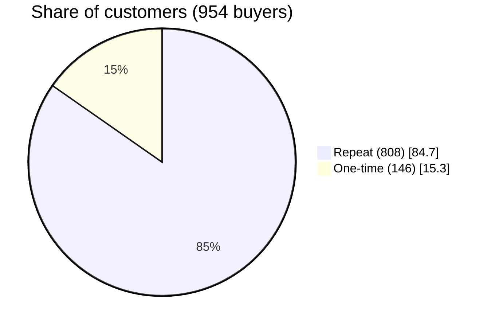
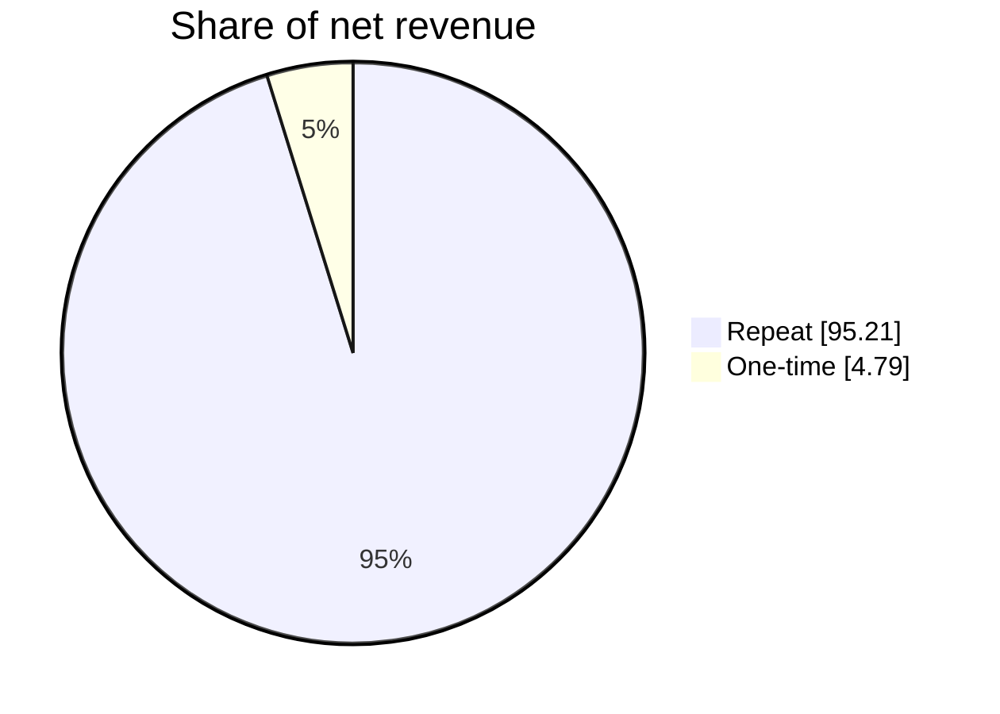
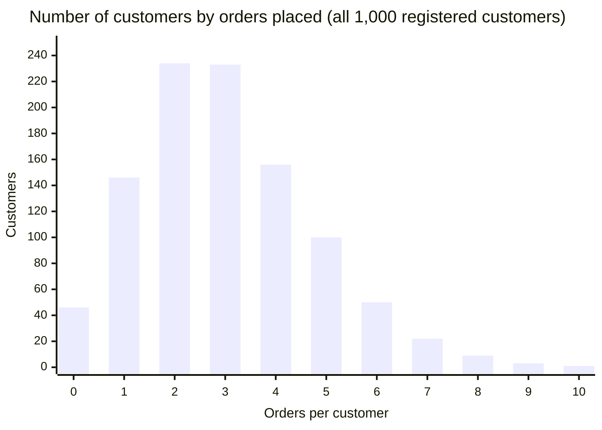
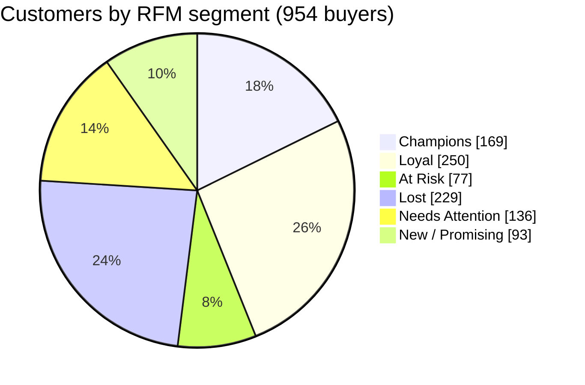
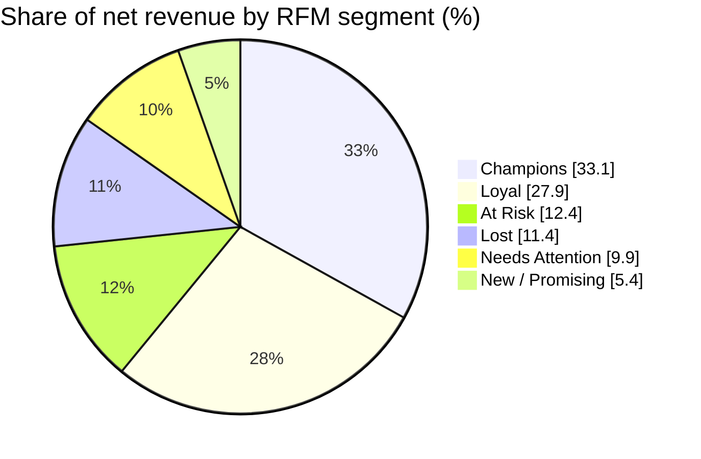
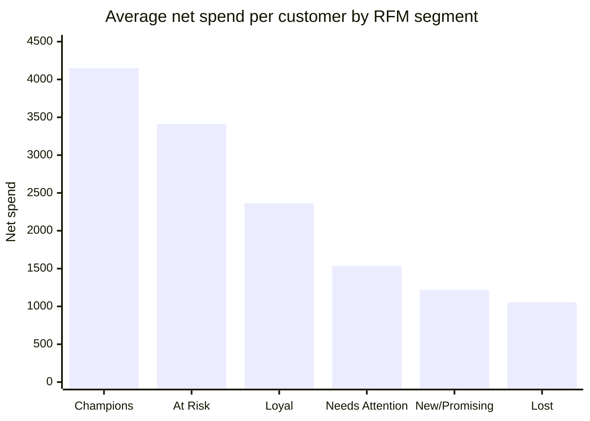

# Ecommerce Customer Analytics: Repeat Purchase, RFM Segmentation & Customer Value

**PostgreSQL (Supabase) · RFM segmentation · Customer lifetime value (CLV) · Churn · Repeat-purchase analysis**

## 🧭 Business Problem

An ecommerce business sells six product categories (Toys, Automotive, Home, Electronics, Fashion and Books), online and in-store, to customers in 10 cities. It has two years of order data (March 2021 to March 2023) but **no clear view of who its customers are or how they behave**. Every customer is treated the same, so retention and marketing budget is spread evenly instead of going where it matters most.

The business needs answers to four questions:

1. **Who comes back?** How many customers stop after one order, and how many return?
2. **Who is worth the most?** Which customers and segments generate most of the value?
3. **Who is slipping away?** Which valuable customers have stopped buying recently?
4. **Where is value being lost?** Which customers return most of what they buy?

**Why it is urgent**
* **Returns are extremely high.** About half of all orders (**50.27%**) were returned. Sales figures look healthy (2.12 million net), but the store kept only **1.07 million**. Judging customers on sales alone overstates their value.
* **Revenue depends on returning customers.** If a small group of high-value buyers drifts away, revenue falls quickly.
* **Activity is fading.** Many buyers have not ordered in months, but without segmentation the business cannot tell a lapsed high-value customer from an occasional shopper.

## 🎯 Objectives

* Analyze customer and transaction data to find distinct purchasing behavior patterns
* Separate **one-time buyers** from **repeat customers** and measure the repeat rate
* Build **RFM segments** using transparent SQL scoring rules
* Measure **customer lifetime value (CLV)** and make a simple 3-year projection
* Identify customers **at risk of churning** (no recent purchase)
* Turn the findings into practical recommendations for retention and targeted marketing

---

## 📊 Key Features

### Customer Analysis Components

* ✅ **Repeat Purchase Analysis**: one-time vs repeat buyers and orders per customer
* ✅ **RFM Analysis**: Recency, Frequency and Monetary scoring (1–5) for every buying customer
* ✅ **Customer Lifetime Value**: historical CLV (money kept) plus a 3-year projection per customer
* ✅ **Churn Risk Assessment**: customers with no purchase in the last 6 or 12 months
* ✅ **Behavioral Segmentation**: first-purchase category, return behavior, non-buyers
* ✅ **Demographic Analysis**: non-buyers by age group and gender; top customers by profile

---

## 💻 Technologies Used

* **SQL (PostgreSQL)**: advanced queries for data extraction, transformation and analysis:
  * **Reusable views:** `CREATE VIEW` (7 views) built inside a `BEGIN … COMMIT` transaction
  * **Multi-step logic:** CTEs (`WITH`) to build results step by step
  * **Window functions:** `NTILE(5) OVER` for RFM scoring, `SUM(…) OVER ()` for percent-of-total, `MIN(…) OVER ()` for full-month flags
  * **Conditional aggregation:** `COUNT(*) FILTER (WHERE …)` and `CASE WHEN` for segment rules and bands
  * **Statistics:** `PERCENTILE_CONT … WITHIN GROUP` for CLV quartiles and the median
  * **Subtotals:** `GROUP BY ROLLUP` for age group and gender subtotals
  * **First-row selection:** `DISTINCT ON` to find each customer's first purchase
  * **Joins:** `LEFT JOIN` (keeps non-buyers), `JOIN … USING`, `CROSS JOIN` (attaches a reference date), `CROSS JOIN LATERAL (VALUES …)` (unpivots dimensions)
  * **Dates:** `TO_DATE` (text dates in DD-MM-YYYY), `DATE_TRUNC`, `EXTRACT`, `INTERVAL` arithmetic, `generate_series` for a calendar table
  * **Data cleaning:** `CAST` / `::numeric`, `COALESCE` (missing values to 0), `NULLIF` (safe division)
* **Supabase**: hosted PostgreSQL database, SQL Editor for running queries and exporting results
* **Claude Code**: AI assistant used for query drafting, validation and documentation
* **GitHub Mermaid**: charts in this README, drawn from the query results

---

## ❓ Business Questions

| # | Question | SQL file | Status |
|---|---|---|---|
| Q1 | How many customers are one-time vs repeat buyers, and what is the repeat rate? | Purchase behavior | ✅ |
| Q2 | What is the distribution of orders per customer? | Purchase behavior | ✅ |
| Q3A | What is customer lifetime value (CLV), and how is it distributed? | Purchase behavior | ✅ |
| Q3B | What is each customer's CLV, plus a simple 3-year projection? | Purchase behavior | ✅ |
| Q4 | Who are the top 20 customers by net revenue? | Purchase behavior | ✅ |
| Q5 | Does a customer's first purchase category predict repeat purchase? | Purchase behavior | ✅ |
| Q6A | What is the RFM segmentation, with segment sizes and revenue? | RFM segmentation | ✅ |
| Q6B | What are the RFM scores and segment for every customer? | RFM segmentation | ✅ |
| Q7 | Who are the 46 customers with no purchases, and what do they look like? | Risk & retention | ✅ |
| Q8 | Which customers have the highest return rates (possible abuse)? | Risk & retention | ✅ |
| Q9 | What is the churn rate (no purchase in the last 6 or 12 months)? | Risk & retention | ✅ |

---

## 🧮 SQL Analysis

The queries are split into three files, run in this order. Each file starts with any views it needs; the analysis queries are read-only `SELECT` statements with their result written below them.

| File | Queries | Topic |
|---|---|---|
| [customer_purchase_behaviour.sql](SQL/customer_purchase_behaviour.sql) | Q1–Q5 | Repeat purchase, orders per customer, CLV, 3-year projection, top customers, first category |
| [segmentation_queries.sql](SQL/segmentation_queries.sql) | Q6A–Q6B | RFM segmentation |
| [customer_risk_retention_analysis.sql](SQL/customer_risk_retention_analysis.sql) | Q7–Q9 | Non-buyers, high return rates, churn |

> ⚠️ Run the files in order. Re-running the first file drops `sales` with `CASCADE`, which also removes `customer_rfm`, so run `segmentation_queries.sql` again afterwards.

```
---

## 🛒 Purchase Behavior Results

### Q1 · One-time vs repeat buyers ✅





**What it shows:**
* The **repeat rate is 84.7%**: most customers come back after their first order.
* One-time buyers are **15.3% of customers** but bring in only **4.8% of revenue**, while repeat buyers bring in **95.2%**. The business depends on returning customers.
* Turning even part of the 146 one-time buyers into repeat buyers is the clearest growth opportunity.

> Revenue here is net (returned orders included). Based on money kept, repeat buyers bring in 95.87%.

### Q2 · Distribution of orders per customer ✅



**What it shows:**
* The most common behavior is **2 or 3 orders** (467 customers, 46.7%). Together with 4 orders, **62.3%** of customers placed 2–4 orders.
* The distribution is **right-skewed**: it drops off quickly after 4 orders. Only **13 customers (1.3%)** placed 8 or more.
* Buyers average **3.14 orders** each (3,000 orders ÷ 954 buyers), and the median buyer placed **3**.
* **46 registered customers (4.6%) never ordered**. They are counted here but excluded from RFM and CLV (see Q7).
* Growth lever: move customers from 2–3 orders to 4+, where Champions and Loyal customers sit.

---

## 🧩 RFM Segmentation

The `customer_rfm` view gives each of the **954 customers who bought something** a score from 1 to 5 on three measures, then a segment label such as Champions or Lost. **Champions are 18% of buyers and bring in 33% of net revenue.**

| Letter | Question | Column | Better when |
|---|---|---|---|
| **R**ecency | How long since they last bought? | `recency_days` | fewer days |
| **F**requency | How many times have they bought? | `frequency` | more orders |
| **M**onetary | How much have they spent? | `monetary` | more spend |

---

### Q6A Result · segment sizes and revenue


| Segment | Customers | % of buyers | Net revenue | Share of revenue | Avg spend per customer | Avg days since last order |
|---|---|---|---|---|---|---|
| **Champions** | 169 | 17.7% | 701,013.94 | **33.1%** | 4,148 | 57 |
| **Loyal** | 250 | 26.2% | 590,144.33 | **27.9%** | 2,361 | 116 |
| **At Risk** | 77 | 8.1% | 262,424.11 | 12.4% | 3,408 | 317 |
| **Lost** | 229 | 24.0% | 241,311.51 | 11.4% | 1,054 | 411 |
| **Needs Attention** | 136 | 14.3% | 208,941.65 | 9.9% | 1,536 | 260 |
| **New / Promising** | 93 | 9.7% | 113,276.24 | 5.4% | 1,218 | 61 |
| **Total** | **954** | 100% | **2,117,111.78** | 100% | 2,219 | – |







**What it shows:**
* **Champions and Loyal** customers together are **44% of buyers** and bring in **61% of net revenue**.
* The **77 At Risk** customers spent an average of about **3,400** each, more than any segment except Champions, but last bought about 317 days ago on average. They are the group most worth contacting before they become Lost.
* **Lost** is the largest segment by headcount (229 customers, 24%) but brings in only 11.4% of revenue.

> `monetary` is net spend **before returns**. About half of all orders were returned, so the money the store kept is roughly half of these figures.
> Full per-customer scores: [results/q6b_rfm_scores.csv](results/q6b_rfm_scores.csv)

---


## 📈 Key Results & Insights

### Customer Behavior & Value ✅

* **Repeat buying is strong (Q1):** 808 of 954 buyers (**84.7%**) ordered more than once. They bring in **95.21%** of net revenue and **95.87%** of kept revenue.
* **Most customers order 2–3 times (Q2):** 2 orders (23.4% of all customers), 3 orders (23.3%). Only 13 customers have 8 or more.
* **CLV is skewed (Q3A):** median kept CLV is **830.15** against an average of **1,120.88**. The 25th / 75th / 90th percentiles are 154.19 / 1,788.11 / 2,656.43.
* **CLV is concentrated:** the top 20% of customers hold **52.1%** of kept CLV.
* **3-year projection (Q3B):** 3,177,842.87 based on net spend, or **1,605,081.66** based on money kept. Both are simple estimates; see [Limitations](#-limitations--future-improvements).
* **Top customers can be misleading (Q4):** customer 430 is #16 by net revenue but kept 0, because all 7 orders were returned.
* **First category doesn't predict loyalty (Q5):** repeat rates range only from 83.0% (Books) to 88.4% (Home), which is within chance.
* **Non-buyers lean older (Q7):** 14 of the 46 customers who never ordered are aged 56–65.
* **Returns erase value (Q8):** 179 customers (18.8%) returned every order, so their kept CLV is 0.
* **Churn risk (Q9):** **47.2%** of buyers had no purchase in the last 6 months; **18.2%** none in 12 months.

### Expected Business Value (not yet measured)

None of these recommendations have been put into practice, so **no business impact is claimed**. These baselines can be used to measure future results:

| Metric | Baseline |
|---|---|
| Repeat-purchase rate | 84.7% |
| 6-month inactive buyers | 47.2% |
| At Risk customers | 77 (12.4% of net revenue) |
| Median kept CLV | 830.15 |
| Return rate | 50.27% |
| At Risk win-back rate | `[To be measured]` |

### Technical Achievements ✅

* Analyzed **3,000 transactions** and **1,000 customers** across 2 years
* Built **7 reusable SQL views** that turn raw tables into customer-level metrics, organized into 3 SQL files
* Validated the data: 0 nulls, 0 duplicates, 0 unmatched orders
* Checked that totals agree: the CLV output adds up exactly to kept revenue (1,069,322.03)
* Kept personal data out of every query and output

---

## 💡 Recommendations

### Based on the results above
1. **Win back At Risk customers** (77 customers, 12.4% of net revenue, ~3,400 average spend) with personalized offers.
2. **Reward Champions and Loyal customers** (61% of net revenue together) with a VIP or loyalty tier.
3. **Nurture New / Promising customers** (93, very recent but few orders) toward a 2nd and 3rd order.
4. **Re-engage inactive buyers** (47.2% with no order in 6 months), starting with those who had high past spend.
5. **Judge value on money kept, not sales.** Review the 179 customers who returned everything before targeting them.


## 🚧 Limitations & Future Improvements

### Known limitations
* **The projection is a simple straight-line estimate.** The original version uses net order value, which includes returned orders (3,177,842.87 in total). The kept-money version, `projected_3yr_kept`, is about half (1,605,081.66). Both assume every customer keeps buying at the same rate, even customers who have gone quiet. For example, customer 398, the #1 by kept CLV, is "At Risk" but is still projected 10,585.10.
* **No cost data:** CLV is based on revenue, not profit.
* **No return reasons or campaign data:** the analysis shows *who* and *how much*, not *why*.
* **RFM is relative:** scores rank customers against each other, and the Monetary score uses net spend, so it includes returned orders.
* **Partial months:** March 2021 and March 2023 are incomplete.

### 💡 Future improvements
* Lower the projection for customers who have gone quiet (add a churn probability)
* Probabilistic CLV models (BG/NBD + Gamma-Gamma)
* K-Means clustering to compare with the rule-based RFM segments
* A segmentation dashboard in `[BI tool]`

---

## 🔧 Technical Architecture

### Data Flow

1. **Raw data** → `tbl_customers` and `tbl_transaction` in Supabase (PostgreSQL)
2. **Data validation** → nulls, duplicates, join check, date conversion, value ranges
3. **SQL views** → order-level `sales` view with calculated fields (net, realised, age group, month)
4. **Customer metrics** → `customer_summary`: orders, spend, returns, first/last purchase, channel mix
5. **Segmentation** → `customer_rfm`: R/F/M scores and segment labels
6. **Analysis** → repeat rate, CLV, projection, churn, returns, non-buyers
7. **Business insights** → recommendations for retention and targeted marketing

### Customer Segmentation Pipeline

```
Transaction Data → Validation → SQL Views → Customer Metrics → RFM Scoring → Segment Analysis → Recommendations

```
## 💻 Key SQL Technique Used

  * **Reusable views:** `CREATE VIEW` (7 views) built inside a `BEGIN … COMMIT` transaction
  * **Multi-step logic:** CTEs (`WITH`) to build results step by step
  * **Window functions:** `NTILE(5) OVER` for RFM scoring, `SUM(…) OVER ()` for percent-of-total, `MIN(…) OVER ()` for full-month flags
  * **Conditional aggregation:** `COUNT(*) FILTER (WHERE …)` and `CASE WHEN` for segment rules and bands
  * **Statistics:** `PERCENTILE_CONT … WITHIN GROUP` for CLV quartiles and the median
  * **Subtotals:** `GROUP BY ROLLUP` for age group and gender subtotals
  * **First-row selection:** `DISTINCT ON` to find each customer's first purchase
  * **Joins:** `LEFT JOIN` (keeps non-buyers), `JOIN … USING`, `CROSS JOIN` (attaches a reference date), `CROSS JOIN LATERAL (VALUES …)` (unpivots dimensions)
  * **Dates:** `TO_DATE` (text dates in DD-MM-YYYY), `DATE_TRUNC`, `EXTRACT`, `INTERVAL` arithmetic, `generate_series` for a calendar table
  * **Data cleaning:** `CAST` / `::numeric`, `COALESCE` (missing values to 0), `NULLIF` (safe division)

### Segmentation Techniques

* ✅ SQL-based RFM scoring with `NTILE(5)` (splits customers into 5 equal groups)
* ✅ Rule-based segment assignment (Champions, Loyal, At Risk and others)
* ✅ Percentile analysis of CLV (25th, 50th, 75th and 90th percentiles)

```  

📦 Project Deliverables

| Deliverable | Link | Status |
|---|---|---|
| Purchase behavior & CLV (views + Q1–Q5) | [SQL/customer_purchas##e_behaviour.sql](SQL/customer_purchase_behaviour.sql) | ✅ |
| RFM segmentation (Q6A–Q6B) | [SQL/segmentation_queries.sql](SQL/segmentation_queries.sql) | ✅ |
| Risk & retention (Q7–Q9) | [SQL/customer_risk_retention_analysis.sql](SQL/customer_risk_retention_analysis.sql) | ✅ |
| RFM scores for all customers | [results/q6b_rfm_scores.csv](results/q6b_rfm_scores.csv) | ✅ |


---
### 🔒 Privacy

Names, emails and phone numbers are **never selected or published**. Customers appear only as `Customer_ID`, and raw data files are not included in this repository.

---

## 👤 Author

**`[Mumtarin Aishee Rabeya]`**
* GitHub: [@Mumtarin-Aishee](https://github.com/Mumtarin-Aishee)
* LinkedIn: `[https://www.linkedin.com/in/mumtarin/]`
* Portfolio / contact: `[aimumtarin@gmail.com]`

**Methods:**
- Reusable SQL views and customer-level metrics
- Repeat-purchase and order-frequency analysis
- RFM segmentation (Recency, Frequency, Monetary)
- Historical CLV with a simple 3-year projection
- Churn windows, and channel, category and return analysis

All of it was written in PostgreSQL.


